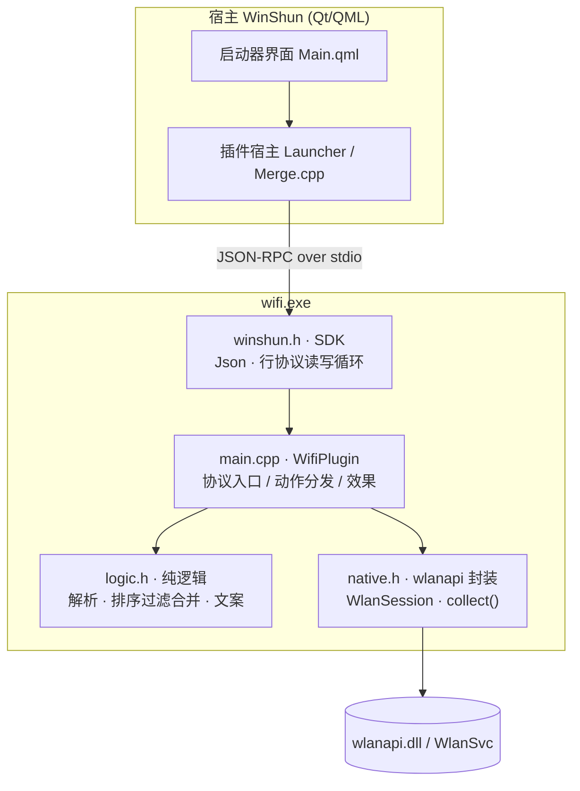
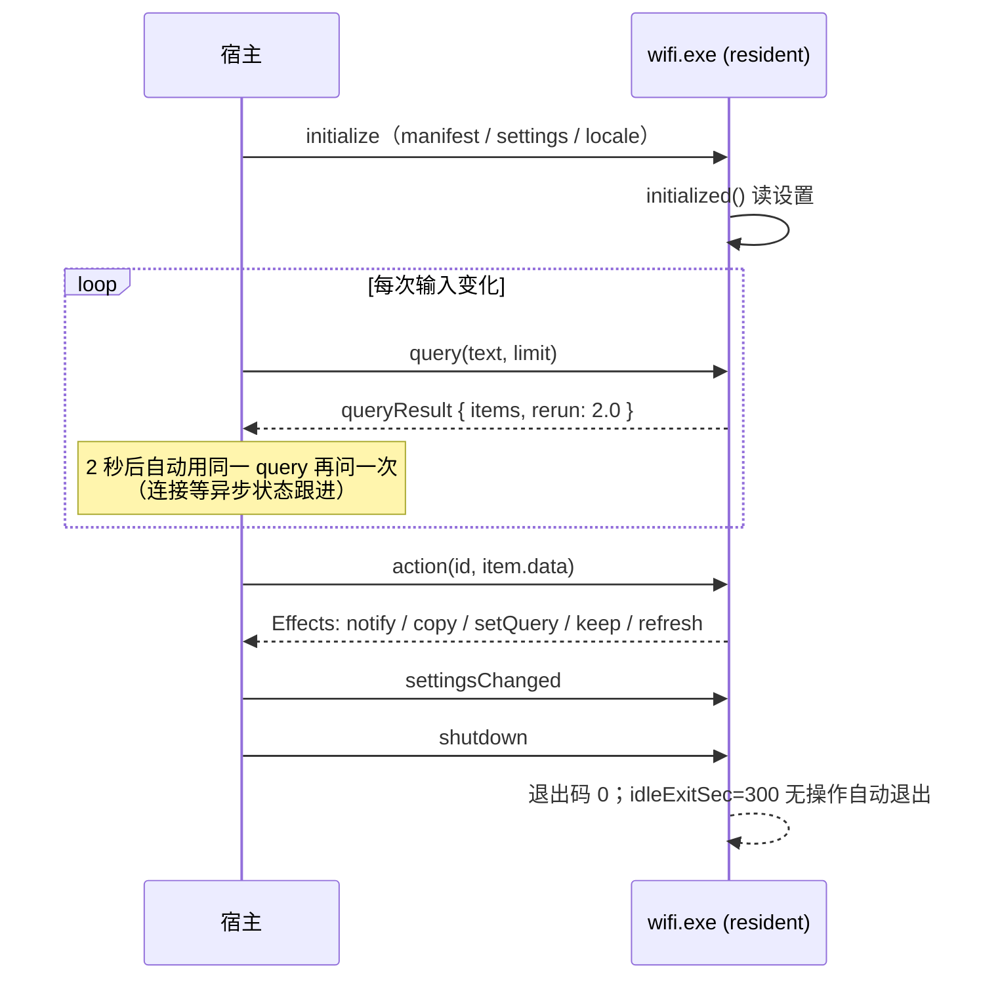
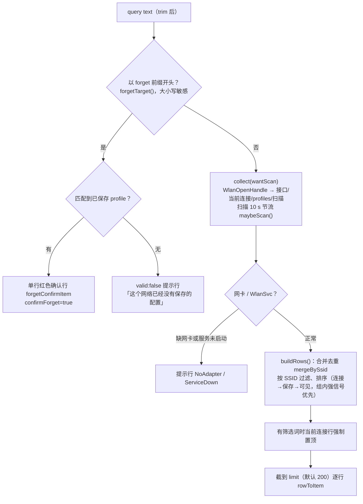
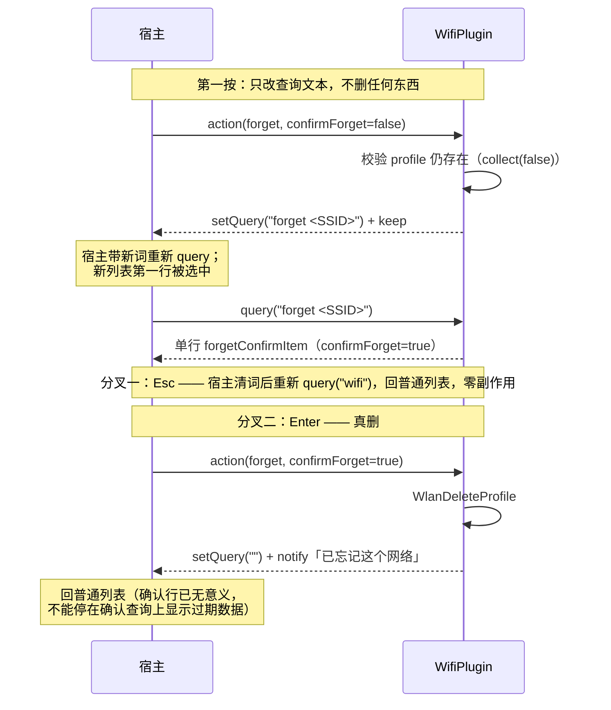

# ra9fael.wifi 开发文档

## v0.2.0 二维码扩展

`wifi` 已保存网络新增 copyQr、previewQr、saveQr。使用实际 WLAN profile 名与网卡定位配置，动作时重读明文；查询结果只携带网络和配置身份。`wifi_qr.h` 校验认证、转义 WIFI 载荷并渲染，`qrcode.h` 为从 ra9fael.qr 复用的 MIT 编码器，`qr_image.h` 使用 Win32/GDI+ 实现剪贴板、PNG 和独立消息线程预览，无 Qt 依赖。

预览显示后调用 SetForegroundWindow、SetActiveWindow、SetFocus；重复打开先销毁旧窗口。宿主在用户动作前通过 AllowSetForegroundWindow 授权插件激活。新权限为 ui 与 Pictures 写入，保留 elevated 和 clipboard:write。只有 saveQr 会写含连接凭据的 PNG。

`wifi_tests` 覆盖特殊字符、中文、隐藏网络、WEP、WPA3、企业认证、受保护或缺失密码，以及配置名与 SSID 不同的合并行为。`wifi_qr_native_tests` 使用虚构数据覆盖动作和 PNG，`--ui` 额外验证复制图片、连续预览的前台/键盘焦点、Esc 关闭。测试不改变真实网络连接。发布验证见 [validation-0.2.0.md](validation-0.2.0.md)。


面向想读懂或改这个插件的开发者。功能语义见[功能规格](spec.md)，测试与实测记录见[测试规格](tests.md)，用户视角见[用户指南](user.md)。

## 1 仓库布局

| 路径 | 内容 |
|---|---|
| `main.cpp` | 插件入口：`WifiPlugin`，协议入口、动作分发、效果返回 |
| `logic.h` | 纯逻辑（ns `wifiname`）：XML/SSID/认证解析、排序过滤合并、行文案、`forget` 前缀。不碰 wlanapi，可单测 |
| `native.h` | wlanapi 封装（ns `wifiname`）：`WlanSession`、`collect()` 快照、连接/断开/删配置、剪贴板 |
| `winshun.h` | Win顺 插件 SDK（vendor 进来的单头文件）：JSON、`Plugin` 基类、stdio 行协议循环 |
| `plugin.json` | 清单：关键词、动作、设置、runtime 参数 |
| `tests/test_wifi.cpp` | L1 纯逻辑单测（190 断言，ctest 驱动，无需无线网卡） |
| `e2e/` | 真机驱动脚本：`run_e2e.py`（协议往返）、`probe_scan.cpp`（直看 `WlanGetNetworkBssList`）、`case_forget_real.py` |
| `docs/` | 本文档与规格 |

## 2 架构分层

纯 Win32 + CRT 的单个 `wifi.exe`，静态链接 CRT，无 Qt 依赖。四层单向依赖：



依赖方向严格向下：`logic.h` 只依赖 SDK 的 JSON（`tests/` 只编 logic + SDK 就能跑，[CMakeLists.txt:44](../CMakeLists.txt)），`native.h` 只依赖 wlanapi，`main.cpp` 把两者接起来。`serve()` 的 stdio 事件循环在 `winshun.h` 的 `Plugin` 基类里（[winshun.h:835](../winshun.h)），插件只覆写 `query` / `queryResult` / `action` / `settingsChanged`。

## 3 协议生命周期

resident 模式：进程常驻，JSON-RPC over stdio。清单参数（[plugin.json](../plugin.json)）→ 运行时行为：



`rerun: 2.0` 只在 `queryResult`（[main.cpp:117](../main.cpp)）里加，普通 `query` 不加——动作后的 `refresh()` 走的是宿主重新 query 的路径。冷启动实测 median 49 ms（清单 `timeoutMs` 3000），常驻工作集 5.9 MB（`memoryMB` 64），预算内余量很大。

## 4 查询管线

`build()`（[main.cpp:173](../main.cpp)）是所有行的唯一出口：



要点：

- **合并去重**在 [logic.h `mergeBySsid`](../logic.h)：同 SSID 多 BSSID 取信号最强；profile 与扫描结果合为一行，明文密码跨合并保留
- **0 dBm 视为未知信号**，排序时垫底（`signalKey` 把它排到 -1000），不冒充强信号
- 每行带 `data`（ssid/bssid/interface/saved/connected/open）回传，动作请求原样带回来，`action()` 不需要重新查询就能干活
- 行文案全部在 `logic.h`（`rowSubtitle` / `rowTitle` / `hintTitle`），中英由 `plugin.chinese()` 决定，未知项（信号、信道）不输出成 0

## 5 动作分发

`action()`（[main.cpp:126](../main.cpp)）按 `a.action` 分发到六个 `doXxx`，全部返回 Effects 且 `keep()`（列表原地不动，靠通知行/`rerun` 反馈结果）：

| 动作 | 关键路径 | 失败语义 |
|---|---|---|
| `connect` | 已保存→`connectProfile`；开放→`connectOpen`；已连接→只通知；加密无 profile→引导系统设置 | `WlanConnect` 失败→「连接失败」，不假成功 |
| `disconnect` | `WlanDisconnect` + `refresh()` | 行内报错 |
| `password` | `readPlaintextKey` → `m_revealed[ssid]` + `copy` + `refresh()` | 拒绝→「需要管理员」；无 key→「没有密码」；blob 仍加密→报错 |
| `copyPassword` | 同上但不入 `m_revealed` | 同上 |
| `copyXml` | `profileXml(plaintext=true)` 原文 `copy` | key 仍 `protected` 时照常复制但注明「密码段需管理员」 |
| `forget` | 两段确认，见 §6 | 组策略（error 5/87）→「可能由组策略管理」 |

**提权模型**：插件不自行提权、不起子进程（清单无 `processes`）。密码读取直接带 `WLAN_PROFILE_GET_PLAINTEXT_KEY` 请求，**按返回结果判断**而不是看自己像不像管理员——实测（2026-11-08）普通权限对当前用户自己的 profile 通常直接返回明文。完整裁决与理由见[功能规格 §4.1](spec.md)。

## 6 forget 的两段确认：把确认态放进查询文本

这是本插件最关键的宿主交互设计，完整推理见[功能规格 §4.2](spec.md)。核心约束：宿主的 `replace` effect 会原地换列表且**没有历史栈**，Esc 会直接关窗口；而把确认态编码进查询文本（`forget <ssid>`）后，宿主重新查询时新列表第一行必被选中（`m_replacePending`），Esc 清词后回到普通查询——真正的回退。



边界都测了（tests.md 第 12 组）：`forget ` 前缀**大小写敏感**（搜 `Forget HJJ` 是普通过滤）、SSID 含空格/中文、SSID 本身叫 `forget me` 时用 `forget forget me` 到达。

## 7 状态与内存安全

- `m_revealed`（[main.cpp:157](../main.cpp)）：本会话已展示的明文密码，按配置名存内存。不落盘、不写日志、进程退出即清零；`shutdown` 后宿主重启进程会重新读 profile
- `WlanOpenHandle` 每次动作/查询即开即关（`WlanSession` RAII），常驻不长期占句柄
- 密码明文只流经内存与 `effect::copy`；XML 原文处理无转义拼接，特殊字符密码不受影响
- 零落盘有双重验证：源码层审计 + E2E 全目录 grep 口令字符串（tests.md §2.10 / §3.1.13）

## 8 构建与测试

```powershell
cmake -S . -B build -G Ninja -DCMAKE_BUILD_TYPE=Release
cmake --build build
ctest --test-dir build
```

- MSVC 环境：先 `vcvars64.bat` 再跑 ninja（cmd 单引号静默失败的坑见仓库级构建笔记）；MSVC `/W4` 零警告是基线
- 非 MSVC：`-static` 静态链接 libgcc/libstdc++，同样零警告
- 产物 `wifi.exe` 直接落在仓库根（`RUNTIME_OUTPUT_DIRECTORY` 指到 `CMAKE_SOURCE_DIR`），因为 `plugin.json` 的 `runtime.program` 按目录根找它
- 链接库：`wlanapi`（全部调用）、`ole32`（GUID）、`user32`（剪贴板）

三层测试，预算与职责：

| 层 | 驱动 | 需要网卡 | 覆盖 |
|---|---|---|---|
| L1 单测 | `ctest`（`tests/test_wifi.cpp`） | 否 | logic.h 全部：XML/SSID/认证解析、排序过滤合并、确认前缀、文案、设置（190 断言） |
| 协议往返 | `e2e/run_e2e.py` 直驱 wifi.exe stdio | 否（profile 路径） | initialize→query→action→shutdown、rerun、通知、冷启动/内存预算 |
| 真机 E2E | 同上 + `probe_scan.cpp` | 是 | 扫描/IE 判定/连接断开/真删 forget，见 tests.md §3.1 |

改完代码的最小回环：`cmake --build build && ctest --test-dir build`，协议行为变化再跑一次 `run_e2e.py`。

## 9 发布

打包内容（git 跟踪的非隐藏源码、文档、图标、清单、许可证，加上构建的 wifi.exe）、SHA-256 记录、tag → GitHub Release 流程、安装/升级/卸载/回滚，见[发布与安装](release.md)。发布前核对：`plugin.json` 的 `version`、CHANGELOG 节、真机 E2E 关键项（连接/断开/forget 至少过一轮）。
