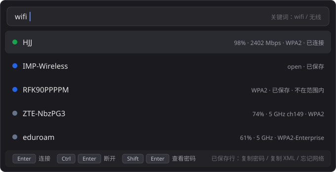
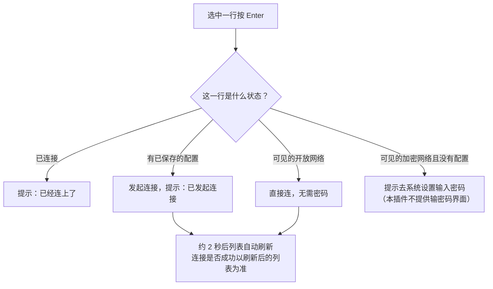
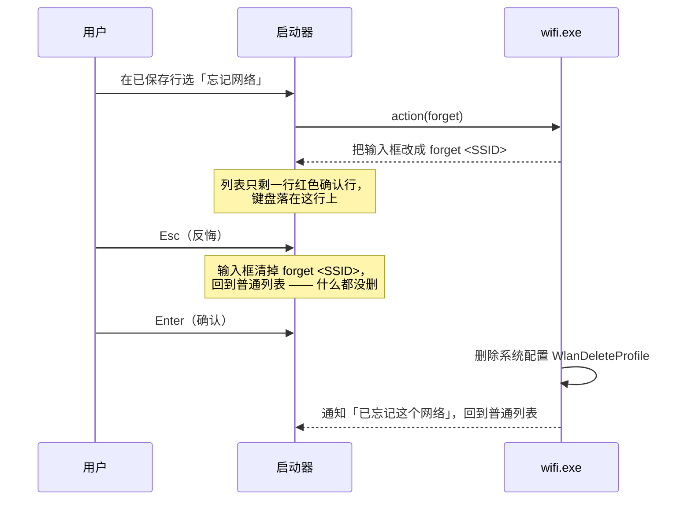
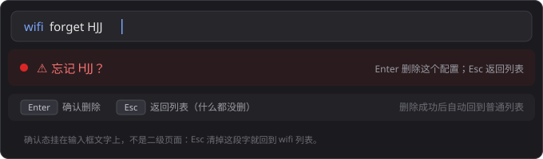

# ra9fael.wifi 用户指南

搜索框直达的 Wi-Fi 管理：看当前连接与信号、连接/断开、查密码、忘记网络、复制配置 XML。数据全部来自 Windows 原生 `wlanapi`（与系统设置同一来源），不解析 netsh 文本。

安装方法见[发布与安装](release.md)。

## 1 基本用法

在 Win顺 搜索框输入 **`wifi`** 或 **`无线`**，回车进入。列表分三段：

1. **当前连接** —— SSID、信号 %、链路速率、认证方式、频段/信道
2. **已保存的配置** —— 含当前不在范围内的
3. **附近可见的网络** —— 按信号从强到弱；同名网络（双频路由器两个 BSSID）合并为一行取最强

圆点颜色：🟢 绿 = 已连接 · 🔵 蓝 = 已保存 · ⚪ 灰 = 仅可见（开放网络为橙色）。

输入文字可按 SSID 过滤（不区分大小写、支持中文）；即使不匹配，**当前连接的行始终置顶保留**。

## 2 快捷键

| 按键 | 作用 | 适用行 |
|---|---|---|
| `Enter` | 连接 | 可连接的行 |
| `Ctrl+Enter` | 断开 | 当前连接的行 |
| `Shift+Enter` | 查看密码（自动复制到剪贴板） | 已保存的行 |
| 右键/操作菜单 | 复制密码、二维码复制/预览/保存、复制配置 XML、忘记网络 | 已保存的行 |

### 连接

连接是异步的：发起后插件只说「已发起连接」，**成功与否看约 2 秒后自动刷新出的列表**（行会变成「已连接」）。范围外的已保存网络也可能发起失败，同样以刷新结果为准。

### 查看密码

`Shift+Enter` 读取明文密码并复制到剪贴板，行内会追加 `密码 ********`（打码显示）。密码只存在于内存和剪贴板，**不写任何文件、不进日志**；进程退出即消失。

- 普通权限下，对当前用户自己的网络通常就能读到明文（已实测）
- 系统拒绝时插件会明确提示「需要以管理员身份运行 Win顺」，**不会给假成功**
- 开放网络没有密码，会如实提示

不想打码：插件设置里关掉「**密码默认打码**」，查看后行内直接显示明文。

### Wi-Fi 二维码

在已保存网络的动作菜单中选择「复制 Wi-Fi 二维码」「预览 Wi-Fi 二维码」或「保存 Wi-Fi 二维码 PNG」。当前连接也可使用这些动作。预览弹出后立即获取焦点，按 Esc 关闭；窗口只显示网络名和二维码，不显示密码原文。

图片使用标准 WIFI 载荷，支持开放、WEP、WPA/WPA2/WPA3 个人网络。企业网络不提供二维码动作；权限不足、密码仍加密或认证不支持时显示原因，不生成空密码的假码。请先在 Windows 连接新网络，保存配置后再分享。

只有保存动作会把图片写到 `%USERPROFILE%\Pictures\wifi-qr-日期-时间-序号.png`，已有文件不会被覆盖。该图片含有连接凭据。预览与复制不会自动保存文件。原来的 `qrwifi` 命令已删除。

### 忘记网络

删除是不可逆操作，所以有两步确认：

要点：

- **按两次 Enter 才会真删**，第一按只是把确认页带出来
- **Esc 是真正的反悔**：回到普通列表，没有删任何东西
- 删除的是 Windows 系统里的 WLAN 配置文件，可用 `netsh wlan show profiles` 交叉核对
- 组策略下发的配置删不掉时，会提示「可能由组策略管理」

## 3 复制配置 XML

「复制配置 XML」把 Windows 的 profile XML 原文复制到剪贴板（可用于备份或导入其他机器）。若当前权限读不出明文密码段，会注明「密码段需管理员」——XML 已复制，只是 `keyMaterial` 段仍是密文。

## 4 常见问题

**列表里看不到任何网络？**
冷启动后第一次查询，扫描（10 秒节流）可能还没返回，可见网络先为空；列表会自动刷新补全，或再输一次 `wifi`。

**提示「WLAN 电台已关闭」？**
飞行模式或硬件开关把无线电台关了，去系统设置打开 WLAN。

**加密的新网络连不上（没有输密码的地方）？**
本插件刻意不做密码输入界面——新网络请在 Windows 系统设置里连一次，之后它成为「已保存」，本插件就能接管了。

**查看密码提示要管理员？**
当前权限被系统拒绝读取明文（常见于域环境/组策略下发的配置）。以管理员身份运行 Win顺 再试，或用「复制配置 XML」拿密文版。

**我的密码会被存到哪里？**
哪里都不存。只在内存里（供本会话显示）和剪贴板里（你复制的那一刻），不落盘、不写日志。已通过全目录文本搜索验证。

## 5 权限说明

插件声明 `elevated`（跟随 Win顺 的管理员权限）与 `clipboard:write`（复制密码/XML）。插件**不会自己弹 UAC**、不起子进程、不访问网络之外的东西。

---

开发与架构见[开发文档](dev.md)；功能裁决细节见[功能规格](spec.md)。
